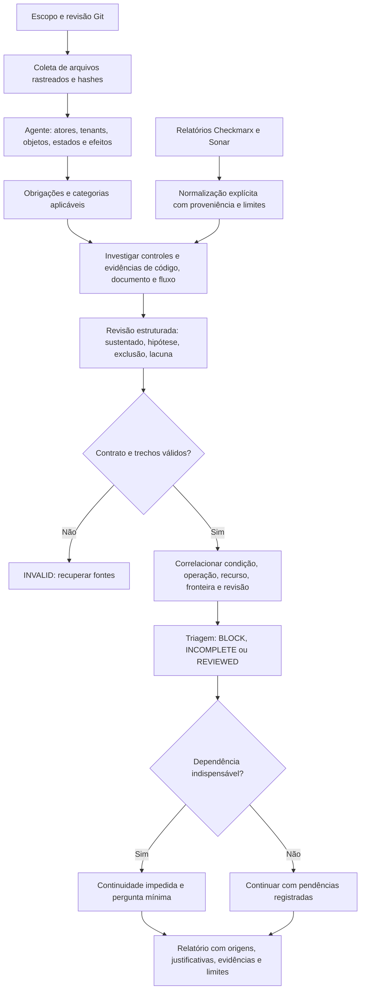

# Security Verification Skill

Skill isolada para revisar segurança contextual de APIs. O agente relaciona identidade, tenants, objetos, regras de negócio e fronteiras de confiança; Python valida evidências declaradas e aplica regras reproduzíveis de encaminhamento. Não depende de Intent e não chama automaticamente um modelo, scanner ou serviço externo.

Esta primeira implementação permite comparar método, contratos, decisões e limites com outra solução. O repositório original estava vazio no clone. O planejamento anterior foi recuperado do chat **Configurar backend-quality-gate** e de `backend-quality-gate/docs/security-planning.md` na branch `docs/quality-gate-planning`; a decisão posterior de isolamento substitui a dependência de Intent prevista naquele documento.

## Fluxo completo



## Executar e inspecionar

Requisitos: Python 3.10+ e Git no PATH; sem pacotes Python externos para o motor. Execute da raiz do clone:

```text
python -m unittest discover -s tests -v
python examples/build_scenarios.py work/scenarios
python -m security_gate triage --context work/scenarios/context.json --review work/scenarios/scanner-overlap.review.json --policy policies/security-v1.json --out work/result.json --report work/report.md
```

O último comando retorna 1 porque a fixture representa um achado bloqueador. Isso é resultado esperado, não falha do programa. Os JSON contêm a avaliação explícita escrita para cada cenário; o gerador não analisa o código para descobri-la.

Para uma revisão real, selecione arquivos relevantes e a revisão commitada:

```text
python -m security_gate collect --repo CAMINHO_REPO --revision HEAD --paths src/api.py docs/security.md --out work/context.json
python -m security_gate triage --repo CAMINHO_REPO --context work/context.json --review work/review.json --policy policies/security-v1.json --out work/result.json --report work/report.md
```

Entre os comandos, o agente lê as fontes, investiga o fluxo e escreve `review.json` conforme o contrato. Alterações locais fora do commit não são analisadas pelo coletor. Não copie os nomes de arquivos do exemplo sem adaptá-los ao repositório alvo. Relatórios externos precisam de evidência sanitizada no snapshot de auditoria; a revisão analisada deve corresponder à declarada pelo scanner.

O pacote pode ser lido diretamente por um agente a partir de `SKILL.md`. Nenhuma instalação global ou configuração de Claude Code/Cursor é feita por estes comandos. O motor CLI é independente do cliente; descoberta automática e experiência de invocação nesses clientes não foram testadas nesta entrega.

## Quatro cenários sintéticos

| Cenário | Evidência comportamental | Resultado esperado |
|---|---|---|
| `correct` | Handler seguro rejeita U-A ao consultar fatura de B e permite fatura de A. | `REVIEWED`, continuidade permitida; só o fluxo declarado. |
| `cross-tenant` | Handler inseguro retorna o valor da fatura B para ator A. | `BLOCK`, continuidade permitida. |
| `scanner-overlap` | Mesmo caminho inseguro e relatório Checkmarx **sintético** da mesma condição/revisão. | `BLOCK`, um registro contextual enriquecido com origem externa; falha preservada. |
| `insufficient-coverage` | Obrigação desconhecida e scan obrigatório não executado. | `INCOMPLETE`, continuidade permitida; sem vulnerabilidade confirmada. |

Os testes executam funções Python da fixture e verificam o comportamento entre empresas. Os testes do motor usam avaliações estruturadas predefinidas; não medem capacidade de um modelo de descobrir vulnerabilidades. `aaaaaaaa...` é revisão sintética deliberada nos exemplos, não commit real; por isso não use `--repo` nesses cenários.

## Decisões e leitura detalhada

- [SKILL.md](SKILL.md): roteiro de uso pelo agente e fronteiras.
- [Método contextual](references/method.md): seleção OWASP API 2023 e quatro lentes complementares, impacto e investigação.
- [Contrato e S-01 a S-10](references/contract.md): tipos, referências, precedência de decisão, continuidade, integridade e erros.
- [Integração externa](references/external.md): normalização, deduplicação e limites de Checkmarx/Sonar.
- [Validação e comparação](docs/validation.md): testes executados, lacunas e critérios para comparar soluções.
- `examples/build_scenarios.py`: gera entradas, resultados e relatórios completos para inspeção.
- `security_gate/core.py`: validador e encaminhamento; `__main__.py`: coleta/CLI/renderização.

Os nomes OWASP adotam explicitamente a [edição 2023](https://owasp.org/API-Security/editions/2023/en/0x11-t10/), sem alegação de catálogo completo ou edição mais recente. Severidade vem do impacto contextual, não do rótulo.

## Limites desta entrega

Sem análise corporativa, scan real, exploração, adaptadores proprietários ou benchmark semântico. Não há agrupamento automático por semelhança de causa ou integração com Intent/Coverage. O agente precisa declarar obrigações e abrangência honestamente; o validador não descobre obrigações omitidas nem prova que uma evidência foi interpretada corretamente. Um snapshot coerente também precisa de conferência de origem (`--repo`) no uso real. `REVIEWED` é conclusão limitada ao conjunto declarado, não aprovação universal de segurança.
